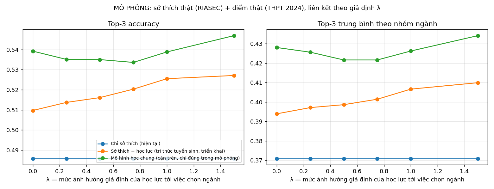

# Mô hình ML gợi ý nhóm ngành (MajorGuide career-family model)

Hệ thống gợi ý **3 nhóm ngành phù hợp** từ hai nguồn:

1. **Sở thích (học máy):** mô hình dự đoán nhóm ngành mà người có hồ sơ sở thích RIASEC giống bạn thường theo học (mục 1–8).
2. **Học lực (tri thức tuyển sinh, không bắt buộc):** điểm các môn → điểm các tổ hợp xét tuyển → mức phù hợp học lực của từng nhóm ngành, đặt trên phổ điểm thi THPT 2024 thật (mục 10).

```
ml/
├── career/
│   ├── taxonomy.py      17 nhóm ngành, luật gán ngành tự do -> nhóm, ánh xạ 40 profile của app
│   ├── prepare_data.py  tải + làm sạch + gán nhãn dữ liệu
│   ├── features.py      đặc trưng mức thang đo (dùng chung train/serve)
│   ├── inference.py     dự đoán, hiệu chỉnh, giải thích, chọn câu hỏi tiếp theo (dùng chung train/serve)
│   ├── train.py         kiểm định thang đo, so sánh mô hình, đánh giá, xuất artifact + biểu đồ
│   ├── academic.py      tổ hợp xét tuyển, môn trọng tâm, academic fit, fusion (nguồn gốc của bản TypeScript)
│   ├── prepare_scores.py  điểm thi THPT 2024 → phân vị từng tổ hợp
│   └── simulate_academic.py  nghiên cứu mô phỏng học lực + sinh academic-reference.ts
├── artifacts/           career_family_model.joblib, model_card.json, cat_tables.json, combo_quantiles.json
├── reports/             metrics.json, data_report.json, scores_report.json, academic_simulation.json, *.png
└── data/                (gitignored) dữ liệu tải về
```

## Chạy lại

```bash
cd agentic-ai/ml
../venv/Scripts/python -m career.prepare_data    # tải ~6 MB, làm sạch, gán nhãn
../venv/Scripts/python -m career.train           # ~7 phút; --quick để chạy thử (~2 phút)
# Học lực: đặt Diemthi2024_processed.csv vào data/ (nguồn ở mục 10.1)
../venv/Scripts/python -m career.prepare_scores        # phân vị tổ hợp từ ~1,06 triệu thí sinh
../venv/Scripts/python -m career.simulate_academic     # ~1 phút; sinh lại academic-reference.ts
cd .. && ./venv/Scripts/python -B -m unittest discover -s tests
```

API (FastAPI, cần header `X-Internal-Token`): `POST /career-prediction/v2/score`,
`POST /career-prediction/v2/next-scale`, `GET /career-prediction/v2/model-card`.

## 1. Dữ liệu

| | |
|---|---|
| Nguồn | Open-Source Psychometrics Project — *RIASEC_data12Dec2018* (CC BY-NC-SA 4.0) |
| Bản ghi gốc | 145.828 người, 48 câu Holland (1 = Không thích … 5 = Rất thích) |
| Làm sạch | đủ 48 câu → **không tick 3 từ giả** (VCL6/9/12, phát hiện trả lời ẩu) → không trả lời một kiểu → thời gian làm bài hợp lý → tuổi 13-80: còn 107.232 |
| Gán nhãn | cột `major` (ngành tự do, tiếng Anh) → 17 nhóm bằng luật regex có xử lý viết sai (psycology, buisness…): **62.312 bản ghi** |
| Mất cân bằng | Tâm lý học 12.390 vs Du lịch 616 (×20) — do khảo sát đặt trên website tâm lý học |

Chi tiết từng bước và các ngành chưa gán được: `reports/data_report.json`.

## 2. Kiểm định thang đo (psychometrics)

| Thang | R | I | A | S | E | C |
|---|---|---|---|---|---|---|
| Cronbach's α | 0.870 | 0.890 | 0.856 | 0.834 | 0.834 | 0.898 |

Phân tích nhân tố khám phá (6 nhân tố, xoay varimax): **48/48 câu tải cao nhất vào đúng thang của mình** →
cấu trúc 6 thang RIASEC được xác nhận, đủ tin cậy (α > 0.8) để dùng điểm trung bình thang làm đặc trưng.

## 3. Đặc trưng và mô phỏng bài test thích ứng

App chỉ hỏi một phần câu sở thích (12 câu lõi = 2 câu/thang, rồi thêm câu thích ứng), và câu chữ khác bộ gốc.
Vì vậy mô hình dùng **đặc trưng mức thang đo**, không dùng từng câu:
điểm trung bình 6 thang (0..1), hồ sơ tương đối (trừ mức trung bình cá nhân), độ phân hóa,
độ cao và **tính nhất quán** của mã 2 chữ trên lục giác Holland.

Khi train, mỗi người được lấy mẫu 2 lần với **2-8 câu ngẫu nhiên mỗi thang**, để mô hình học được
điểm nhiễu của bài test ngắn. Giới tính và tuổi **không** được dùng làm đặc trưng.

## 4. So sánh mô hình (5-fold CV, tập train 80%)

| Mô hình | Top-1 | Top-3 | Macro top-3 | Log-loss |
|---|---|---|---|---|
| Đoán theo tần suất | 0.199 | 0.388 | 0.177 | 2.620 |
| **Cosine theo luật (hệ thống cũ)** | 0.099 | 0.322 | 0.292 | 3.176 |
| Logistic regression | 0.250 | 0.500 | 0.326 | 2.401 |
| Random forest | 0.246 | 0.493 | 0.322 | 2.413 |
| **MLP (64-32) — được chọn** | 0.250 | 0.499 | 0.331 | **2.399** |
| CatBoost | 0.244 | 0.492 | 0.328 | 2.428 |

Độ lệch chuẩn giữa các fold ≤ 0.004. Mô hình được chọn theo log-loss vì app dùng **xác suất**, không chỉ nhãn.
Bốn mô hình học máy ngang nhau → giới hạn nằm ở thông tin trong 6 điểm sở thích, không ở thuật toán.

> Phát hiện chính: thuật toán cosine cũ có **top-3 thấp hơn cả việc đoán theo tần suất**.
> Mô hình ML cải thiện top-3 thêm **+16 điểm %** so với hệ thống cũ (cùng dữ liệu, cùng cách đo).

## 5. Hiệu chỉnh và sửa lệch nhãn

* **Temperature scaling** trên 10% tập train giữ lại: T = 1.03 (MLP vốn đã gần hiệu chỉnh, ECE = 0.007).
* **Sửa label shift**: tập dữ liệu thừa ngành tâm lý so với học sinh Việt Nam, nên xác suất được chia cho
  prior của tập nguồn mũ β. Chọn β trên tập hiệu chỉnh để cân bằng top-3 tổng thể và top-3 theo từng nhóm:

| β | 0 | 0.25 | **0.5** | 0.75 | 1 |
|---|---|---|---|---|---|
| Trung bình điều hòa (top-3, macro top-3) | 0.397 | 0.410 | **0.413** | 0.409 | 0.383 |

## 6. Kết quả trên tập test (20%, chưa từng dùng khi train)

Điều kiện giống app: **3-4 câu mỗi thang**.

| | Top-1 | Top-3 | Top-5 | Macro top-3 | Macro-F1 | ECE |
|---|---|---|---|---|---|---|
| Đoán theo tần suất | 0.199 | 0.388 | 0.530 | 0.177 | 0.020 | — |
| Cosine theo luật (cũ) | 0.098 | 0.310 | 0.465 | 0.282 | 0.096 | 0.122 |
| MLP + hiệu chỉnh | 0.246 | 0.487 | 0.639 | 0.317 | 0.099 | 0.007 |
| **MLP + hiệu chỉnh + sửa prior (triển khai)** | 0.224 | 0.469 | 0.621 | **0.357** | **0.128** | 0.040 |

Với đủ 48 câu: top-3 = 0.505. Với chỉ 2 câu mỗi thang: 0.444. Mô hình giữ được hiệu năng khi bài test ngắn.

Ngẫu nhiên chọn 3 trong 17 nhóm chỉ đúng 17.6%; mô hình đúng 47%. Đây là mức hợp lý với một mô hình **chỉ dùng
sở thích** (thực tế chọn ngành còn phụ thuộc năng lực, điểm thi, gia đình…). Vì vậy app trình bày kết quả là
"gợi ý để khám phá", không phải kết luận.

**Theo từng nhóm** (top-3 recall): Tâm lý 0.74, Kinh doanh 0.62, Kỹ thuật 0.53, Khoa học sự sống 0.52,
Y tế 0.50 … Luật 0.06, Du lịch 0.02. Ma trận nhầm lẫn (`reports/confusion_matrix.png`) cho thấy mô hình nhầm
giữa các ngành **có mã Holland gần nhau**: nhóm Social (giáo dục, xã hội, thể thao) nhầm sang tâm lý,
nhóm Enterprising/Conventional (tài chính, du lịch) nhầm sang kinh doanh. Điều này đúng với lý thuyết lục giác RIASEC.

**Độ quan trọng của từng thang** (top-3 giảm khi thay thang đó bằng mức trung bình cá nhân):
S 6.6 điểm, R 4.3, I 3.3, A 1.8, E 1.1, C 0.9.

**Công bằng**: top-3 nam 0.434, nữ 0.486. Chênh lệch 5 điểm dù không dùng giới tính làm đặc trưng. Nguyên nhân
là các ngành phổ biến ở nữ (tâm lý, y tế) dễ dự đoán hơn trong dữ liệu này. Cần theo dõi khi có dữ liệu thật của app.

## 7. Hỏi thích ứng (computerized adaptive testing)

Mô phỏng 1.500 người ở tập test, tất cả bắt đầu bằng 12 câu lõi (2 câu/thang) như app,
sau đó hỏi thêm 12 câu sở thích theo từng chiến lược:

| Số câu sở thích | 12 | 16 | 20 | 24 |
|---|---|---|---|---|
| EIG thuần (giảm entropy kỳ vọng lớn nhất) | 0.411 | 0.431 | 0.434 | 0.441 |
| Ngẫu nhiên | 0.411 | 0.433 | 0.447 | 0.458 |
| Xoay vòng các thang | 0.411 | 0.441 | 0.476 | 0.466 |
| **Cân bằng + EIG phân định (triển khai)** | 0.411 | 0.433 | 0.451 | **0.466** |

Kết luận trung thực: **EIG thuần kém nhất**. Nó liên tục hỏi để "xác nhận" ngành đang dẫn đầu, làm phân phối
tự tin hơn chứ không đúng hơn. Điều quan trọng là **phủ đều 6 thang**; EIG chỉ hữu ích để phân định khi các
thang có số câu bằng nhau. App dùng chiến lược "cân bằng + EIG" và xen kẽ tối đa 6 câu sở thích thích ứng với
câu về giá trị/phong cách. Sai số chuẩn của mô phỏng khoảng ±1.3 điểm, nên khác biệt giữa "cân bằng + EIG"
và "xoay vòng" không có ý nghĩa thống kê.

## 8. Cách app sử dụng mô hình

* Bài test hiện tại là **30 câu cố định**, 5 câu mỗi thang, xen kẽ R-I-A-S-E-C. Lý do: mục 7 cho thấy phủ đều các thang
  tốt ngang chọn câu thích ứng, và bộ cố định cho phép học sinh xem sơ đồ câu hỏi và quay lại sửa đáp án.
* Khi nộp bài, NestJS gửi điểm từng thang tới `POST /career-prediction/v2/score` và nhận xác suất 17 nhóm ngành.
* Nếu học sinh nhập điểm, xác suất được điều chỉnh theo học lực (mục 10). Kết quả hiển thị **3 nhóm cao nhất**, mỗi nhóm kèm
  lời giải thích sinh từ template: thang sở thích nổi bật, xác suất của mô hình, tổ hợp tốt nhất và phân vị toàn quốc,
  môn trọng tâm mạnh/yếu, gợi ý trải nghiệm thử.
* Mọi lời gọi có timeout 2.5 s. Khi AI service lỗi, phần sở thích **tự quay về độ tương đồng hồ sơ**, phần học lực vẫn hoạt động.
* Chỉ gửi câu trả lời sở thích theo thang, không gửi danh tính.

## 9. Hạn chế và hướng phát triển

* Dữ liệu là người dùng Internet nói tiếng Anh giai đoạn 2015-2018. Nhãn là ngành **đang học**, không phải ngành **phù hợp/hài lòng**.
* Câu hỏi của app khác câu gốc; giả định là các câu cùng thang đo cùng một cấu trúc (được ủng hộ bởi α và EFA, nhưng nên kiểm chứng lại).
* Bước tiếp theo:
  1. Thu thập dữ liệu thật từ app: phản hồi sau bài test, ngành cuối cùng chọn.
  2. Đo α/EFA trên câu tiếng Việt.
  3. Fine-tune mô hình bằng dữ liệu Việt Nam.
  4. Thêm đặc trưng giá trị/phong cách khi đủ dữ liệu có nhãn.
  5. Train mô hình học chung sở thích + học lực trên dữ liệu Việt Nam (mục 10.5).

## 10. Học lực: kết hợp tri thức tuyển sinh, kiểm chứng bằng mô phỏng

### 10.1 Dữ liệu điểm thật
Điểm thi tốt nghiệp THPT 2024 do Bộ GD&ĐT công bố công khai. Bản tổng hợp theo thí sinh lấy từ
[huggingface.co/spaces/ngocminhta/National-Grad-Score-Ranking-1](https://huggingface.co/spaces/ngocminhta/National-Grad-Score-Ranking-1)
(`Diemthi2024_processed.csv`). Chỉ giữ 9 cột điểm môn; **bỏ số báo danh, tỉnh, khu vực**.

| | |
|---|---|
| Thí sinh | 1.060.013 |
| Khối thi | KHTN 32,6% · KHXH 66,6% |
| Điểm TB | Toán 6,45 · Văn 7,23 · Anh 5,52 (khớp số liệu công bố 2024) |
| Tương quan | Toán–Lý 0,56 · Sử–Địa 0,66 · Hóa–Sinh 0,41 · Toán–Văn 0,42 |

Từ đó tính **phân vị 0–100 của 9 tổ hợp** (A00, A01, B00, B08, C00, D01, D07, D14, D15), ví dụ D01 trung vị 19,65, top 10% từ 24,25.
App dùng trực tiếp các phân vị này: *"Tổ hợp B00 của bạn đạt 27,25/30, cao hơn khoảng 98% thí sinh thi tổ hợp này năm 2024"*.

### 10.2 Công thức (không cần dữ liệu có nhãn)
Mỗi nhóm ngành có các **tổ hợp xét tuyển phổ biến** và **môn trọng tâm** (`academic.py`). Ví dụ: Y tế dùng B00/B08/A00, môn trọng tâm Sinh và Hóa; Luật dùng C00/A00/A01/D01, môn trọng tâm Văn.

```
tổ_hợp   = w_abs · phân_vị_toàn_quốc(tổ hợp tốt nhất) + (1 − w_abs) · mức_nổi_trội(tổ hợp so với điểm TB của chính học sinh)
fit(f)   = 0,75 · tổ_hợp + 0,25 · mức_nổi_trội(môn trọng tâm của f)
p(f)     ∝ P_sở_thích(f) · exp(γ · (fit(f) − 0,5))        (nhóm cần thi năng khiếu dùng γ/2)
```

* `w_abs = 0,6` với **điểm thi thử** và `0,2` với **học bạ**, vì học bạ bị "lạm phát" so với điểm thi nên chủ yếu dùng để biết môn nào nổi trội.
* Thành phần môn trọng tâm tách các nhóm ngành dùng chung một tổ hợp. Ví dụ học sinh giỏi Sinh–Hóa nhưng Văn yếu: Y tế được fit cao hơn Tâm lý dù cả hai đều xét B00.
* Bản TypeScript trong `apps/user-access` được **sinh tự động** từ `academic.py`. Test `academic.spec.ts` đối chiếu với các ca do Python xuất ra (parity test).

### 10.3 Nghiên cứu mô phỏng: vì sao và cách làm
Không có dữ liệu công khai nào ghép **điểm của học sinh Việt Nam** với **ngành họ chọn**, nên không thể đo trực tiếp học lực giúp được bao nhiêu.
Bộ dữ liệu bán tổng hợp được dựng từ **hai nguồn thật và một giả định**:

* Sở thích và ngành học: 62.312 hồ sơ RIASEC thật (mục 1).
* Điểm số: thí sinh THPT 2024 thật.
* Giả định λ: người học nhóm f được lấy ngẫu nhiên trong số thí sinh **thi được ít nhất một tổ hợp của f**, với xác suất ∝ exp(λ·z), z là điểm chuẩn hóa của tổ hợp tốt nhất.
  λ = 0: chỉ khối thi liên quan đến ngành. λ = 1: người học f có điểm tổ hợp của f cao hơn khoảng 1 độ lệch chuẩn.
  **"Độc lập"**: điểm lấy từ toàn bộ thí sinh, hoàn toàn không liên quan đến ngành. Đây là kịch bản xấu nhất, khi giả định sai.

Cùng split 80/20 với mục 6. Sở thích mô phỏng đúng app: 5 câu mỗi thang. γ được chọn **một lần** trên tập validation, lấy giá trị cho kết quả trung bình tốt nhất qua ba kịch bản
(độc lập, λ = 0,5, λ = 1), để quy tắc vẫn an toàn nếu giả định sai. Kết quả: **γ = 1,5**.

### 10.4 Kết quả mô phỏng (tập test, top-3 / top-3 trung bình theo nhóm)

| Kịch bản | Chỉ sở thích | **Sở thích + học lực (triển khai)** | Mô hình học chung (cận trên) |
|---|---|---|---|
| Độc lập (giả định sai hoàn toàn) | 48,6% / 37,1% | 47,1% / 35,6% | 47,6% / 35,5% |
| λ = 0 (chỉ khối thi) | 48,6% / 37,1% | 51,0% / 39,4% | 53,9% / 42,8% |
| λ = 0,5 | 48,6% / 37,1% | 51,6% / 39,9% | 53,5% / 42,2% |
| λ = 1 | 48,6% / 37,1% | **52,6% / 40,7%** | 53,9% / 42,6% |
| λ = 1,5 | 48,6% / 37,1% | 52,7% / 41,0% | 54,7% / 43,4% |



Đọc kết quả:
* Nếu học lực có liên quan đến việc chọn ngành ở mức vừa phải (λ ≈ 1), cách kết hợp theo tri thức tăng top-3 khoảng **+4 điểm %**
  và top-3 trung bình theo nhóm khoảng **+3,6 điểm**, mà **không cần dữ liệu có nhãn**.
* Nếu giả định sai hoàn toàn, chỉ mất **1,5 điểm**. Đây là lý do chọn γ an toàn: trên tập validation, γ = 3 nhỉnh hơn một chút khi giả định đúng nhưng tụt mạnh khi giả định sai (`gamma_grid_by_scenario` trong `reports/academic_simulation.json`).
* Cách kết hợp theo tri thức đạt **khoảng 45–75% mức cải thiện** mà một mô hình được train trên chính dữ liệu mô phỏng đạt được (75% ở λ = 1). Phần còn lại cần dữ liệu có nhãn mới khai thác được.
* Thành phần môn trọng tâm làm kết quả mô phỏng giảm khoảng 0,6 điểm, vì giả định λ chỉ liên kết tổ hợp với ngành chứ không liên kết môn trọng tâm.
  Thành phần này vẫn được giữ vì nó sửa một lỗi logic thật (mục 10.2).

> **Đây là mô phỏng, không phải độ chính xác trên học sinh Việt Nam.** Con số phụ thuộc vào giả định λ.
> Điều mô phỏng chứng minh: (1) pipeline chạy đúng với điểm thật, (2) nếu học lực liên quan đến chọn ngành thì phương pháp tận dụng được,
> (3) nếu không liên quan thì thiệt hại nhỏ và có giới hạn.

### 10.5 Bước tiếp theo
Khi có dữ liệu thật (điểm + ngành đã chọn + mức hài lòng), train mô hình học chung trên dữ liệu Việt Nam và so sánh với các dòng trong bảng trên.
Script `simulate_academic.py` đã có sẵn phần train mô hình học chung, chỉ cần thay bộ dữ liệu.
